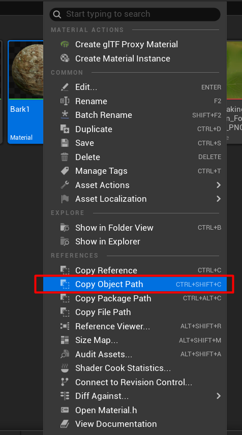
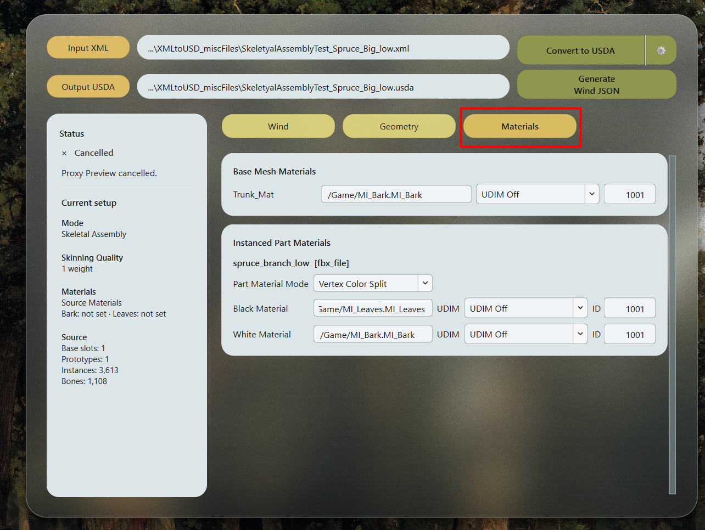
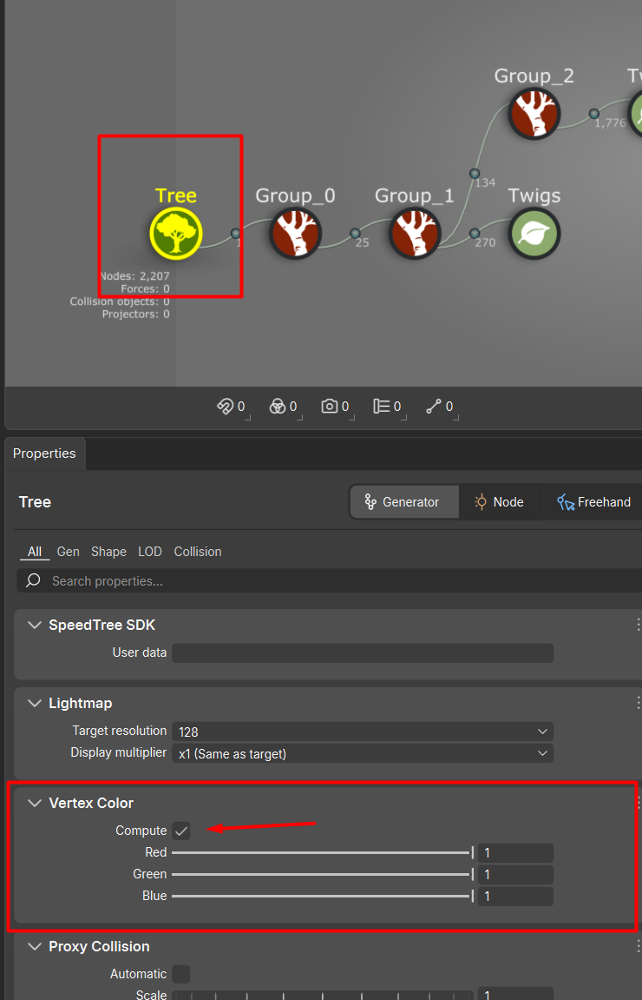
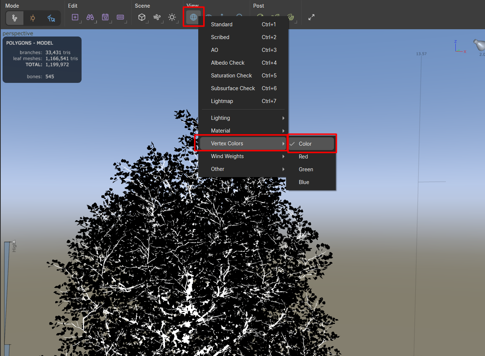
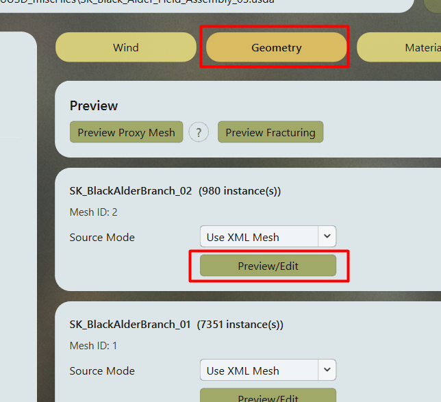
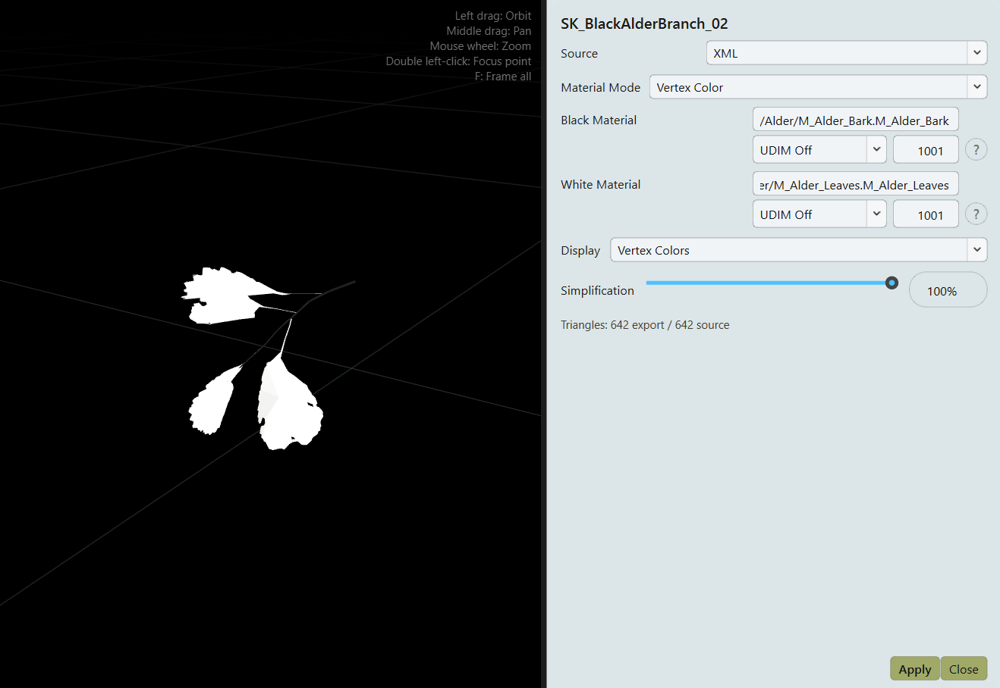

# Assigning materials

The **Materials** tab assigns existing Unreal materials to the plant's base mesh and [repeated branches or leaves](../wiki/choosing-assembly-parts.md). A branch often needs separate bark and leaf materials, even when it is imported into SpeedTree as one Leaf mesh.

## Assign the base-mesh materials

1. In Unreal's **Content Browser**, right-click the material or material instance and choose **Copy Object Path**.
2. In SpeedAssembly, open **Materials** and paste the path into the corresponding row under **Base Mesh Materials**.
3. Repeat for each detected material row.

{ style="max-height: 550px; width: auto;" }

Use the complete Object Path, such as `/Game/MI_Bark.MI_Bark`. SpeedAssembly blocks conversion while required material assignments are missing.

## Choose a material mode for repeated parts

Under **Instanced Part Materials**, choose **Part Material Mode** for each mesh.

| Mode | Source | Assignment |
| --- | --- | --- |
| **Single Material** | [XML](../wiki/xml-usd-usda-json.md#xml-carries-the-speedtree-source) or FBX mesh | One Unreal material for the entire repeated mesh. |
| **Material Slots** | FBX replacement | One Unreal material for each used FBX material slot. |
| **Vertex Color Split** | XML or FBX mesh | Two Unreal materials selected by the mesh's vertex colors. |

Parts using **Use Unreal Reference** retain the material assignments on the existing Unreal mesh asset instead of being reassigned here.

### Single Material

Choose **Single Material** and fill its material path. Use this when the mesh needs only one material, or when a shared atlas material covers both the branch and its leaves.

### Material Slots from FBX

SpeedTree's Raw XML Leaf export provides one material assignment for a repeated mesh. To use the separate slots of your original branch FBX:

1. In **Geometry**, choose **Use FBX File** for the repeated part and select its replacement file.
2. In **Materials**, choose **Material Slots**.
3. Assign an Unreal material to every displayed FBX slot.

The FBX's polygon-to-slot assignments determine which surfaces receive each material. It can have one, two, or more used slots; unused slots do not need rows. Vertex colors are not required for this mode.

The replacement must match the mesh used in SpeedTree in pivot, orientation, and real-world size. See [Prepare repeated branches and leaves](prepare-speedtree.md#prepare-repeated-branches-and-leaves).

## Vertex Color Split {#vertex-color-split}

Vertex colors are RGB values stored on mesh vertices. Here they are a mask for assigning whole polygons to materials, not colors that the Unreal material must display.

Prepare one region in exact black and the other in exact white. For example, leaves can be black and twig bark white. The reverse works too: assign the leaf material to whichever color the leaves use.

Choose **Vertex Color Split**, then fill **Black Material** and **White Material** accordingly.

### Prepare and export colors in SpeedTree

Prepare the branch mesh with the black-and-white regions you need before using it as a Leaf mesh. Keep the split on polygon boundaries rather than painting a gradient between bark and leaves.

1. In SpeedTree's generator graph, select the **Tree** root.
2. In its properties, scroll to **Vertex Color** and enable **Compute** so vertex colors are calculated for export.

{ style="max-height: 750px; width: auto;" }

3. In the viewport's **View** menu, choose **Vertex Colors > Color**.
4. Check that the intended regions are black and white, then export using the [SpeedAssembly XML settings](prepare-speedtree.md#export-for-speedassembly).

**Compute** enables color calculation; it does not decide which surfaces should receive the bark or leaf material. Check the actual exported colors again in SpeedAssembly, especially if the source mesh or SpeedTree color settings change.

### Check the split in Preview/Edit

1. In **Geometry**, find the repeated part and click **Preview/Edit**.

2. In **Material Mode**, select **Vertex Color** and assign **Black Material** and **White Material**.
3. Set **Display** to **Vertex Colors** to inspect the source colors.

4. Set **Display** to **Material Colors** to check the resulting material regions.
5. Click **Apply** to return the assignments to the main window.

The preview has the same material and UDIM settings as the main tabs. Its labels are **Vertex Color** and **FBX Materials**, corresponding to **Vertex Color Split** and **Material Slots** in Materials. Display modes only change preview coloring; they do not change the exported split or render the assigned Unreal shaders.

### Exact polygon rules

Use black RGB `(0, 0, 0)` and white RGB `(1, 1, 1)` for predictable results with either source type. Alpha does not select the material.

- **XML mesh:** every vertex of a polygon must be exact black or every vertex must be exact white. Gray, other colors, and polygons mixing black and white are rejected by the explicit split. Both groups must be present.
- **FBX replacement:** a polygon goes to **Black Material** only when all its vertices are exact black. Any other polygon goes to **White Material**. Both groups must be present.

This is a polygon assignment, not a blended mask. If the mesh needs only one region, use **Single Material**. If it needs more than two independently assigned regions, use an FBX replacement with **Material Slots**.

## UDIMs

Each applicable material assignment has its own UDIM mode and tile ID, including the two color regions or individual FBX slots.

See [UDIM workflow](udim.md) for **Shift UV**, **Write UV1 Offset**, and the Unreal material graph for tileable bark. Those controls work the same way in Materials and Preview/Edit.
