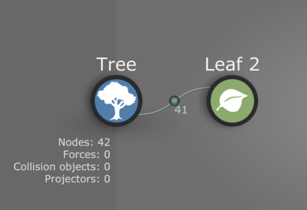
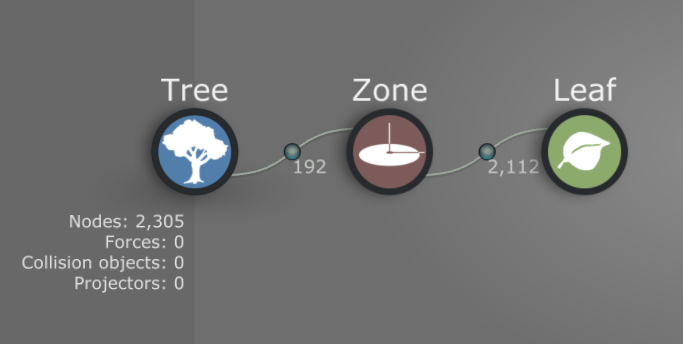
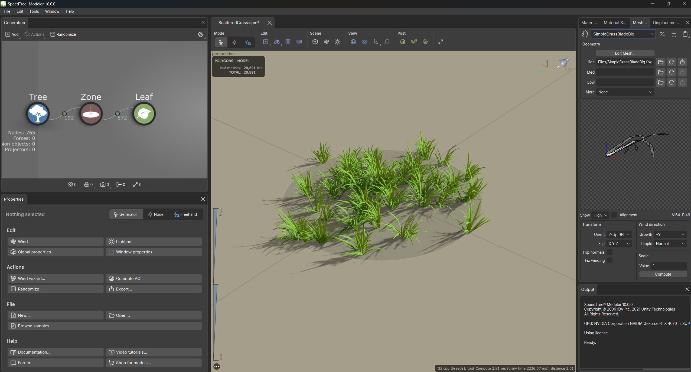
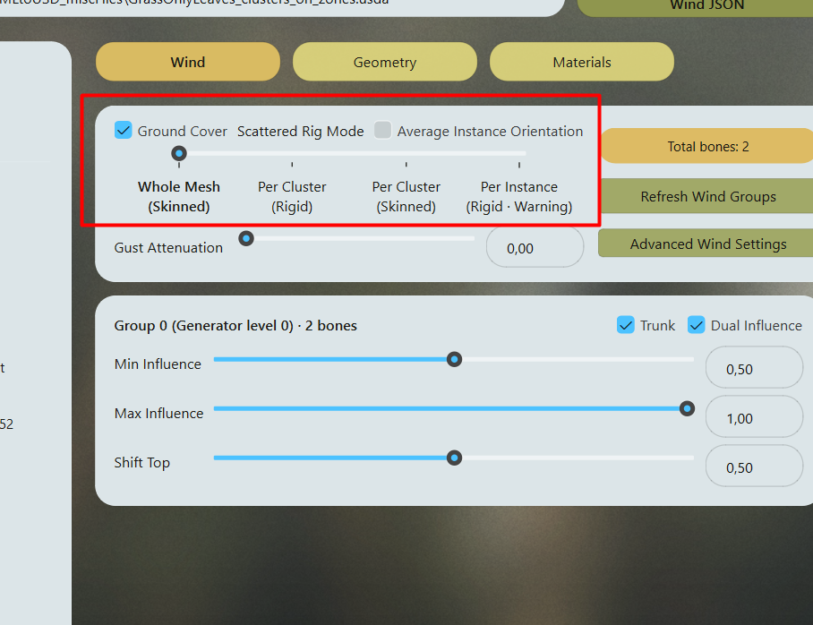

# Scattered Rig

Scattered Rig creates a simple skeleton for plants built entirely from [scattered Leaf meshes](../wiki/choosing-assembly-parts.md). Use it for grass patches, clover, dandelions, and other ground cover that does not need a modeled trunk or branch skeleton.

The mode appears automatically when the [XML](../wiki/xml-usd-usda-json.md#xml-carries-the-speedtree-source) contains repeated leaf geometry but no base mesh or skeleton. SpeedAssembly generates the bones during skeletal conversion. You do not need to create them in SpeedTree.

## Build the SpeedTree graph

Use imported meshes in **Leaf** generators and prepare their size, pivot, and orientation as described in [Prepare SpeedTree](prepare-speedtree.md#prepare-repeated-branches-and-leaves). Keep **Use actual size** enabled.

### One patch without clusters

Connect **Leaf** directly to **Tree** and scatter the meshes across the patch. This setup provides two rig modes: **Whole Mesh (Skinned)** and **Per Instance (Rigid)**.

### A patch made of clusters

Connect **Tree > Zone > Leaf**. Use several Zone instances to place clusters, with multiple Leaf instances inside each one. This adds **Per Cluster (Rigid)** and **Per Cluster (Skinned)**.

SpeedAssembly reads the exported hierarchy, not the generator names. The cluster modes require multiple intermediate groups containing more than one repeated instance each, with all instances belonging to those groups. A Zone generator alone does not guarantee that the exported structure forms clusters.

Export using the same XML settings as [Prepare SpeedTree](prepare-speedtree.md#export-for-speedassembly). Do not add branch geometry or a source skeleton if you want Scattered Rig to be detected.

## Choose a rig mode

In SpeedAssembly, load the XML and open **Wind**. **Scattered Rig Mode** replaces **Skinning Quality**, and **Total bones** shows the generated count.

Every mode has one structural root bone. The remaining bones provide deformation or rigid attachment.

| Mode | Geometry and bones | Use it for |
| --- | --- | --- |
| **Whole Mesh (Skinned)** | Bakes all repeated meshes into one Skeletal Mesh. Uses two bones total, with two-weight deformation across the patch. No repeated parts remain. | A patch that can share one overall wind response with the smallest rig. |
| **Per Cluster (Rigid)** | Adds one attachment bone per cluster, plus the root. Instances in each cluster move together without bending internally. The first cluster is baked to supply the required base mesh; the remaining instances stay instanced. | Cluster-level movement while retaining repeated geometry. |
| **Per Cluster (Skinned)** | Bakes all repeated meshes into one Skeletal Mesh. Adds one deformation bone per cluster, plus the root, and uses two-weight deformation within each cluster. | Clusters that need their own bending response. This is the default for detected clustered input. |
| **Per Instance (Rigid)** | Adds one attachment bone per repeated instance, plus the root. Each mesh moves rigidly with its own bone. One instance is baked as the required base mesh; the rest stay instanced. | Individual motion when cluster-level motion is insufficient. Large scatters can create expensive skeletons. |

For example, 20 clusters produce 21 bones in either Per Cluster mode. A patch with 500 individual instances produces 501 bones in Per Instance mode.

Without clusters, the two middle options are unavailable. Start with Whole Mesh, or build a Zone-based graph if you need independent cluster movement. Use Per Instance only when that finer movement is worth the bone count.

### Bone placement and orientation

Whole Mesh uses the average instance position as its pivot. Cluster modes use the average position within each cluster. Per Instance places a bone at each mesh's attachment point.

By default, the generated bone directions are nearly upright, with a slight tilt for stable Dynamic Wind evaluation. They form a simple root-and-children rig, not a detailed bone chain along each blade.

Enable **Average Instance Orientation** to derive those directions from the placed meshes. Whole Mesh averages the entire patch, Per Cluster averages each cluster, and Per Instance uses each mesh's orientation. Larger placed meshes have more weight in an averaged direction. This changes bone orientation, not the mesh placements.

## Configure and export

1. In **Geometry**, keep **Use XML Mesh** or choose **Use FBX File** for the plant meshes.
2. In **Materials**, fill the required Unreal material paths. See [Assigning materials](materials-tab.md).
3. In **Wind**, choose **Scattered Rig Mode** and review **Average Instance Orientation** and **Total bones**.
4. Configure the wind group response and **Ground Cover** setting. The generated rig initially uses one wind group; **Advanced Wind Settings** can be used for further group editing.
5. Choose **Skeletal Assembly** from the gear beside **Convert to USDA** and export the [USDA file](../wiki/xml-usd-usda-json.md#usda-is-usd-you-can-read).
6. Click **Generate Wind JSON** to export the separate [wind settings](../wiki/xml-usd-usda-json.md#json-carries-the-wind-settings), then follow [Import into Unreal Engine](unreal-import.md), including the required **Transform Provider** setup.

**Use Unreal Reference** is not supported for Scattered Rig skeletal conversion. SpeedAssembly needs local geometry to create the base mesh, including in the rigid modes. Use XML geometry or an FBX replacement instead.

The skinned modes import as ordinary Skeletal Meshes because all repeated geometry is baked. The rigid modes import as Skeletal Nanite Assemblies when repeated parts remain.

Proxy Mesh and Fracturing are unavailable for Scattered Rig input. **Preview/Edit** remains available for inspecting individual plant meshes and configuring their materials.

## Controls {#controls}

??? info "Show control details"

    | Control | Effect |
    | --- | --- |
    | **Scattered Rig Mode** | Chooses whether movement is shared across the whole patch, per cluster, or per instance, and whether geometry bends or stays rigid. Available cluster options depend on the exported hierarchy. |
    | **Average Instance Orientation** | Uses placed-mesh orientations for generated bone directions. Off uses the default nearly upright directions. |
    | **Total bones** | Shows the generated rig size for the current setup. |
    | **Refresh Wind Groups** | Repeats wind inspection after source or rig changes. |
    | **Ground Cover** | Adjusts Dynamic Wind's response for low vegetation. This setting goes into Wind JSON. |
    | **Advanced Wind Settings** | Opens the skeleton viewport for inspecting and editing wind groups. |

See [How Dynamic Wind works](../wiki/how-dynamic-wind-works.md) for the wind response settings and [Choosing what to instance](../wiki/choosing-assembly-parts.md) for repeated-part sizing.
